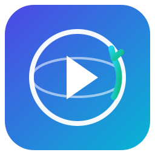

<div dir="rtl" align="center">

<h1>
  <br/>
  Insight Replay
</h1>

<p>
  <strong>أداة self-hosted لتسجيل وإعادة تشغيل جلسات المستخدمين، خرائط الحرارة، وتحليلات حية — بديل Microsoft Clarity تمتلكه بالكامل.</strong><br/>
  ضع سطر <code>&lt;script&gt;</code> واحد على أي موقع وشاهد المستخدمين الحقيقيين وهم يتنقلون، ينقرون، يغضبون، يتحولون لعملاء في الوقت الحقيقي. <em>بدون تسعير SaaS، بدون كوكيز طرف ثالث، بدون بيانات تخرج من جهازك.</em>
</p>

<p>
  <a href="./README.md">English</a> · <strong>العربية</strong>
</p>

</div>

---

## 📌 المحتويات

- [نظرة عامة](#نظرة-عامة)
- [المميزات](#المميزات)
- [البديل لماذا](#البديل-لماذا)
- [التشغيل السريع](#التشغيل-السريع)
- [التقنيات المستخدمة](#التقنيات-المستخدمة)
- [نشر المشروع](#نشر-المشروع)
- [خريطة الطريق](#خريطة-الطريق)
- [المساهمة](#المساهمة)
- [الترخيص](#الترخيص)
- [المؤلف](#المؤلف)

---

## نظرة عامة

**Insight Replay** هو منصة open-source و self-hosted لتسجيل وإعادة تشغيل
جلسات المستخدمين (session replay)، خرائط الحرارة (heatmaps)، والتحليلات
الحية (live analytics) — بديل مخلص وقابل للنشر لـ **Microsoft Clarity**.

سطر `<script>` واحد يسجل كل حركة ماوس، كل نقرة، كل scroll، كل خطأ، وكل
تحويل (conversion). بعدها الـ dashboard يحوّل هذا السيل من البيانات إلى:

- تسجيلات قابلة لإعادة التشغيل بدقة البكسل
- خرائط حرارة للنقرات، حركة الماوس، وعمق الـ scroll
- مؤشرات حية للمؤشرات (live cursors)
- اكتشاف تلقائي للـ rage clicks و dead clicks و JS errors
- مسارات تحويل (funnels) ورحلات مستخدمين (journeys)
- تجارب A/B
- dashboards مخصصة قابلة للسحب والإفلات
- أهداف (goals) وتنبيهات (alerts)
- بحث بلغة طبيعية مدعوم بالـ LLM

الـ stack كامل — Next.js 16 + Prisma + SQLite + Socket.io + SDK مستقل +
138 اختبار — يشغّل على جهاز واحد خلف Caddy gateway. بدون Kafka، بدون
Redis، بدون Postgres، بدون قفل مع أي PaaS. قاعدة البيانات ملف SQLite
واحد، والـ deploy artifact هو Next.js standalone bundle، وكل ده في 256 MB
من الـ RAM.

> **الخلاصة للمستعجل:** `git clone` → `bun install` → `bun run db:push` → `bun run dev` → افتح `http://localhost:3000`. الدليل الكامل في **[USAGE.md](./USAGE.md)**.

---

## البديل لماذا؟

| مشكلة في SaaS | حل Insight Replay |
|---|---|
| تسعير per-session ومفاجآت في الفاتورة | قاعدة بيانات ملف واحد على قرصك؛ استقبل كمية البيانات اللي تريدها |
| عناوين IP خام عند طرف ثالث | IPs تُموه قبل التخزين (آخر octet يصير صفر) |
| كوكيز + لافتات موافقة (consent banners) | بدون كوكيز؛ visitorId في localStorage + sessionId في sessionStorage فقط |
| "ثق فينا، مفيش حد بيشوف تسجيلاتك" | التسجيلات على جهازك؛ مفيش حد عنده صلاحية قراءة |
| قفل الموردين عبر SDK ملكي | SDK مستقل يُخدم من origin بتاعك؛ سطر `<script>` واحد، صفر dependencies |
| ملخصات AI سوداء على ترافيكك | الـ LLM يشتغل في الـ backend عبر `z-ai-web-dev-sdk` بـ prompts منظمة وعقد 200-on-error — فشل صامت مستحيل |

---

## المميزات

Insight Replay فيه **15 tab في الـ dashboard** و **ست طبقات أمنية**. كل
ميزة parity مع Clarity مُنفذة end-to-end (SDK → ingest → DB → query → UI)،
مو مجرد stubs.

### تحليلات وتصوير

1. **مشغل إعادة التسجيل** — إعادة بناء بدقة البكسل لكل جلسة مسجلة، مع timeline قابل للـ scrub، سرعة تشغيل من 0.5× لـ 8×، قفز لـ bookmarks (rage clicks / dead clicks / errors)، وتعليقات المحلل.
2. **خرائط حرارة للنقرات / الحركة / Scroll** — لكل URL، فوق iframe حي للصفحة المتتبَّعة.
3. **مؤشرات حية** — Socket.io على بورت `:3004` يبث صور مؤشر كل ثانية لكل project room.
4. **Funnels و journeys** — تعريف مسارات تحويل متعددة الخطوات + رسوم journey للصفحات الأكثر شيوعاً.
5. **تجارب A/B** — variants بتخصيص موزون، فرضية، أهداف، ودلالة إحصائية.
6. **Dashboards مخصصة** — grid قابل للسحب والإفلات مع layouts ثابتة في قاعدة البيانات.
7. **أهداف وتنبيهات** — URL-match أو event-name، تنبيهات على `sessions / rageClicks / errors / conversions / bounceRate / avgDuration` بقواعد `gt | lt | drops | spikes`.
8. **Feed تنبيهات** — اكتشاف تلقائي للـ rage clicks / dead clicks / quick-backs / excessive-scroll / JS errors عند الـ ingest.

### التتبع، SDK، والذكاء الاصطناعي

9. **SDK تتبع مستقل** — يُخدم من `/api/track/script.js?pid=<id>&port=3004` فأي موقع (حتى static HTML) يقدر يشترك بسطر واحد.
10. **Ingest batching مع backpressure** — الـ SDK يخزّن الأحداث محلياً وي flush كل 4 ثواني أو 40 حدث، وعند `visibilitychange` / `pagehide` / error.
11. **بحث بلغة طبيعية مدعوم بالـ AI** — اسأل "أرني جلسات من Firefox عملت rage click على صفحة الأسعار الأسبوع اللي فات".
12. **تحليل جلسة وملخص مشروع بالـ AI** — ملخص نوعي لكل جلسة + ملخص أسبوعي للـ friction patterns و converting paths.

### الأمان والامتثال

13. **ست طبقات أمان** — API key auth، rate limiting على الـ edge (100 req/min/IP → 429 + `Retry-After: 60`)، CORS + origin validation في الـ production، تمويه IP قبل التخزين، audit logging على كل mutation، و security headers صارمة.
14. **GDPR right-to-erasure** — DELETE ينشئ `VisitorTombstone` بـ unique constraint يمنع إعادة إنشاء الجلسة microseconds بعدها (race-safe على مستوى الـ DB).
15. **Bootstrap للأدمن مرة واحدة** — `bootstrapLock` بـ unique constraint يمنع إنشاء أدمنين متزامنين.
16. **Power-of-work لتسجيل الدخول** — PoW challenge قبل تشغيل password verify، فالـ brute-force يصير مكلف اقتصادياً.
17. **SSRF guard** — يمنع webhook/alert delivery لـ link-local و loopback و metadata-service IPs، ويهزم DNS-rebinding.

---

## التشغيل السريع

> **المتطلبات**: [Bun](https://bun.sh) ≥ 1.3 (أو Node ≥ 20)، [Git](https://git-scm.com) ≥ 2.30.

```bash
# 1. نسخ المستودع
git clone https://github.com/automate-it0/insight-replay.git
cd insight-replay

# 2. تثبيت dependencies
bun install

# 3. إعداد المتغيرات البيئية
cp .env.example .env
./scripts/generate-secret.sh   # → SESSION_SECRET
./scripts/generate-secret.sh   # → ADMIN_TOKEN
# عدّل .env وضع القيم

# 4. تهيئة قاعدة البيانات
bun run db:generate    # ينشئ Prisma client
bun run db:push        # ينشئ ملف SQLite + الجداول

# 5. إنشاء أول أدمن (مرة واحدة)
curl -X POST http://localhost:3000/api/auth/setup \
  -H "Content-Type: application/json" \
  -d '{"email":"admin@example.com","password":"change-me-please","name":"Site Admin"}'

# 6. تشغيل الـ servers (محطتين)
bun run dev                              # الـ dashboard على :3000
bun mini-services/live-service/index.ts  # الـ live-service على :3004
```

افتح <http://localhost:3000>، سجل دخول بالأدمن اللي عملته، اضغط **New Project**،
انسخ الـ `<script>` tag، الصقه على أي صفحة HTML، وشاهد الجلسات تتدفق.

> 📖 **الدليل الكامل بالخطوات والصور**: **[USAGE.md](./USAGE.md)**.

---

## التقنيات المستخدمة

| الطبقة | التقنية | الإصدار | السبب |
|--------|---------|---------|------|
| Runtime | [Bun](https://bun.sh) | ≥ 1.3 | binary واحد، TypeScript أصلي، أسرع من Node في الـ hot paths |
| Framework | [Next.js](https://nextjs.org) (App Router) | 16.1 | server components + route handlers + standalone output |
| Language | [TypeScript](https://www.typescriptlang.org) | 5.x | types صارمة في كل الكود |
| Database | [SQLite](https://www.sqlite.org) عبر [Prisma](https://www.prisma.io) | 6.11 | zero-config، ملف واحد، مثالي للـ self-hosted |
| Styling | [Tailwind CSS](https://tailwindcss.com) | 4.x | utility-first |
| UI | [shadcn/ui](https://ui.shadcn.com) + [Radix UI](https://www.radix-ui.com) | latest | primitives متاحة و themeable |
| Charts | [Recharts](https://recharts.org) | 2.15 | React charting composable |
| State | Zustand + TanStack Query + TanStack Table | 5.x / 5.x / 8.x | فصل نظيف بين UI state / server cache / tables |
| Realtime | [Socket.io](https://socket.io) | 4.8 | مؤشرات حية على `:3004` |
| AI | [z-ai-web-dev-sdk](https://www.npmjs.com/package/z-ai-web-dev-sdk) | 0.0.18 | LLM للبحث وتحليل الجلسات |
| Gateway | [Caddy](https://caddyserver.com) | 2.x | reverse proxy بـ HTTPS تلقائي |
| Testing | Bun test + [Playwright](https://playwright.dev) | latest | 138 unit + E2E |
| Container | [Docker](https://www.docker.com) (multi-stage) | — | `Dockerfile` ينتج slim production image |

---

## نشر المشروع

ثلاثة مسارات مدعومة، مرتبة حسب البساطة:

### المسار 1 — Docker (مُوصى به للـ self-host)

```bash
docker build -t insight-replay:0.7.1 .

docker run -d --name insight-replay \
  -p 3000:3000 \
  -e DATABASE_URL=file:/data/custom.db \
  -e SESSION_SECRET=$(./scripts/generate-secret.sh) \
  -e ADMIN_TOKEN=$(./scripts/generate-secret.sh) \
  -e ALLOWED_ORIGINS=https://insight.example.com \
  -e NODE_ENV=production \
  -v insight-replay-db:/data \
  --restart unless-stopped \
  insight-replay:0.7.1
```

### المسار 2 — Vercel (للـ dashboard + API فقط)

Vercel لا يدعم العمليات طويلة الأمد، فالـ live-service لازم ينفصل على host آخر (Fly.io، Railway، VPS). اضبط `src/components/app/use-tracker.ts` ليشير لـ live-service host.

### المسار 3 — VPS (bare metal / systemd)

الأكثر إنتاجاً. يركب نفس طريقة التطوير المحلي لكن تحت systemd و Caddy. تعليمات كاملة في [USAGE.md](./USAGE.md#13-docker-any-os).

---

## خريطة الطريق

### v0.7.x — *مسار تقوية الأمان (الحالي)*

- [x] ست طبقات أمان
- [x] GDPR right-to-erasure بـ race-safe tombstones
- [x] Bootstrap للأدمن مرة واحدة (DB-level mutex)
- [x] Power-of-work لتسجيل الدخول
- [x] SSRF guard
- [x] WCAG 2.1 AA (63 إصلاح في 21 مكون)

### v0.8.x — *تحسين UX + onboarding*

- [ ] جولة onboarding داخل التطبيق
- [ ] دمج heatmap على الـ replay
- [ ] Segments محفوظة + اقتراحات ذكية بالـ AI
- [ ] Dark mode افتراضي
- [ ] Dashboard متعدد اللغات (ar / en / fr / es)

### v0.9.x — *SDK v2 + الأداء*

- [ ] tracker مبني على Web Worker
- [ ] SharedArrayRing buffer لأكثر من 5k events/sec
- [ ] Cross-tab visitor stitching
- [ ] SDK size budget ≤ 8 KB gzipped
- [ ] benchmark suite علني مقابل PostHog + Plausible + Clarity

### v1.0.0 — *الإتاحة العامة*

- [ ] Signed-replay integrity
- [ ] Plugin system للـ custom insight detectors
- [ ] Team management + RBAC
- [ ] Postgres adapter (اختياري؛ SQLite يبقى الافتراضي)
- [ ] SOC 2 Type 1 self-assessment

---

## المساهمة

شكراً لاهتمامك بالمساهمة! Insight Replay يتطور trunk-based مع Conventional
Commits، PRs تحت 400 سطر، و CI كـ merge gate. اقرأ [CONTRIBUTING.md](./CONTRIBUTING.md)
أولاً — يغطي إعداد التطوير، الاختبارات، صيغة الـ commit، استراتيجية
الـ branching، عملية الـ PR، حماية الـ branches، توقعات الـ code review،
انضباط الـ ADR، وانضباط الـ CHANGELOG.

```bash
git checkout -b feat/<short-description>
# عدّل الكود، أبقي الـ PR atomic و أقل من 400 سطر
./scripts/check-quality.sh   # نفس الـ gate بتاع CI
git commit -m "feat(api): add /api/projects/[id]/segments endpoint"
git push -u origin feat/<short-description>
# افتح PR يستهدف main
```

### المسائل للمبتدئين

- [`good first issue`](https://github.com/automate-it0/insight-replay/labels/good%20first%20issue) — صغيرة ومحددة المعالم
- [`help wanted`](https://github.com/automate-it0/insight-replay/labels/help%20wanted) — سطح أكبر، التصميم واضح
- [`documentation`](https://github.com/automate-it0/insight-replay/labels/documentation) — تحسينات التوثيق دايماً مرحب بها

---

## الترخيص

Insight Replay تحت **[MIT License](./LICENSE)**.

```
MIT License

Copyright (c) 2025 Ziad Mohamed Kishk

Permission is hereby granted, free of charge, to any person obtaining a copy
of this software and associated documentation files (the "Software"), to deal
in the Software without restriction, including without limitation the rights
to use, copy, modify, merge, publish, distribute, sublicense, and/or sell
copies of the Software, and to permit persons to whom the Software is
furnished to do so, subject to the following conditions:

The above copyright notice and this permission notice shall be included in all
copies or substantial portions of the Software.

THE SOFTWARE IS PROVIDED "AS IS", WITHOUT WARRANTY OF ANY KIND, EXPRESS OR
IMPLIED, INCLUDING BUT NOT LIMITED TO THE WARRANTIES OF MERCHANTABILITY,
FITNESS FOR A PARTICULAR PURPOSE AND NONINFRINGEMENT. IN NO EVENT SHALL THE
AUTHORS OR COPYRIGHT HOLDERS BE LIABLE FOR ANY CLAIM, DAMAGES OR OTHER
LIABILITY, WHETHER IN AN ACTION OF CONTRACT, TORT OR OTHERWISE, ARISING FROM,
OUT OF OR IN CONNECTION WITH THE SOFTWARE OR THE USE OR OTHER DEALINGS IN
THE SOFTWARE.
```

---

## المؤلف

**Insight Replay** من تأليف وصيانة:

- **Ziad Mohamed Kishk** — _قائد المشروع والمُشرف الوحيد_
  - GitHub: [@automate-it0](https://github.com/automate-it0)

المساهمون في GitHub Contributors graph على
<https://github.com/automate-it0/insight-replay/graphs/contributors>.
السجل الزمني لكل مهمة ومساهم في [`worklog.md`](./worklog.md) — append-only،
كل سجل فيه Task ID، Agent، Task، Work Log، Stage Summary.

---

<div dir="rtl" align="center">

<sub>مبني بـ Next.js 16، Bun، Prisma + SQLite، Socket.io، shadcn/ui، و Recharts.</sub><br/>
<sub>دي نجمة ⭐ للمستودع لو Insight Replay وفّر عليك فاتورة SaaS الشهر ده.</sub>

</div>
