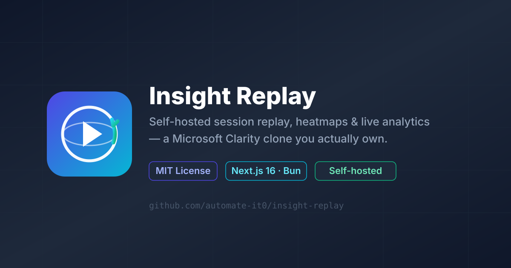

<!-- -*- markdown -*- vim: set ft=markdown: -->
<h1 align="center">
  <br/>
  Insight Replay
</h1>

<p align="center">
  <strong>Self-hosted session replay, heatmaps &amp; live analytics — a Microsoft Clarity clone you actually own.</strong><br/>
  Drop a one-line <code>&lt;script&gt;</code> tag onto any site and watch real users navigate, click, rage, and convert in real time. <em>No SaaS metering. No third-party cookies. No data leaving your box.</em>
</p>

<p align="center">
  <a href="https://github.com/automate-it0/insight-replay/releases"></a>
  <a href="./LICENSE"></a>
  <a href="https://github.com/automate-it0/insight-replay/stargazers"></a>
  <a href="https://github.com/automate-it0/insight-replay/network/members"></a>
  <a href="https://github.com/automate-it0/insight-replay/issues"></a>
  <a href="https://github.com/automate-it0/insight-replay/blob/main/CONTRIBUTING.md"></a>
  <br/>
  <a href="https://bun.sh"></a>
  <a href="https://nodejs.org"></a>
  <a href="https://nextjs.org"></a>
  <a href="https://www.prisma.io"></a>
  <a href="https://ui.shadcn.com"></a>
  <a href="https://socket.io"></a>
  <a href="https://www.docker.com"></a>
</p>

<p align="center">
  <a href="#-quick-start">🚀 Quick Start</a> ·
  <a href="#-features">✨ Features</a> ·
  <a href="#-screenshots">📸 Screenshots</a> ·
  <a href="#-why-insight-replay">🤔 Why</a> ·
  <a href="#-roadmap">🗺️ Roadmap</a> ·
  <a href="#-documentation">📚 Docs</a> ·
  <a href="#-contributing">🤝 Contributing</a> ·
  <a href="./USAGE.md">📖 Usage Guide</a> ·
  <a href="./README.ar.md">🌍 العربية</a>
</p>

<!-- HERO IMAGE — the og-image. Replace with a real screenshot / GIF when art is ready. -->
<p align="center">
  
</p>
<p align="center"><em>Replace <code>public/og-image.svg</code> with a real 1200×630 PNG (or a 5-second demo GIF) when art is ready. A live GIF on the hero section typically doubles the star rate.</em></p>

---

## 📑 Table of contents

- [Overview](#overview)
- [Features](#-features)
- [Quick start](#-quick-start)
- [Screenshots](#-screenshots)
- [Why Insight Replay](#-why-insight-replay)
- [Tech stack](#-tech-stack)
- [Project structure](#-project-structure)
- [Environment variables](#-environment-variables)
- [Deployment](#-deployment)
- [Roadmap](#-roadmap)
- [Documentation](#-documentation)
- [Contributing](#-contributing)
- [Star history](#-star-history)
- [License](#-license)
- [Acknowledgements](#-acknowledgements)
- [Author](#-author)

---

## Overview

**Insight Replay** is an open-source, self-hosted session-replay, heatmap, and
live-analytics platform — a faithful, deployable clone of **Microsoft Clarity**.
A single `<script>` tag records every mouse move, click, scroll, error, and
conversion; the dashboard turns that firehose into replayable recordings,
click/move/scroll heatmaps, live cursors, rage-click and dead-click insights,
funnels, journeys, A/B experiments, custom dashboards, goals, alerts, and an
LLM-powered natural-language search over the whole thing.

The entire stack — Next.js 16 App Router dashboard, Prisma + SQLite data layer,
Socket.io realtime mini-service, standalone tracking SDK, and 138 tests — runs
on one box behind a Caddy gateway. No Kafka, no Redis, no Postgres, no
managed-PaaS lock-in. The database is a single SQLite file, the deploy artifact
is a Next.js standalone bundle, and the whole thing fits in 256 MB of RAM.

> **TL;DR for the impatient:** `git clone` → `bun install` → `bun run db:push` → `bun run dev` → open `http://localhost:3000`. Full walkthrough in **[USAGE.md](./USAGE.md)**.

### 🤔 Why Insight Replay?

| SaaS analytics pain point | Insight Replay's answer |
|---|---|
| Per-session pricing & metering surprises | Flat-file DB on your own disk; ingest as much as you want |
| Raw IPs in someone else's cloud | IPs anonymized *before* storage (last octet zeroed); deterministic fake-geo from the anonymized value |
| Cookies + consent banners | No cross-site cookies; first-party `localStorage` visitorId + `sessionStorage` sessionId only; right-to-erasure tombstones enforced at the DB level |
| "Trust us, we don't look at your recordings" | Recordings live on your box; nobody else has read access |
| Vendor lock-in via proprietary SDK | Standalone SDK served from your own origin; one `<script>` tag, zero dependencies |
| Black-box AI summaries of your traffic | LLM features run via `z-ai-web-dev-sdk` in the backend, with structured prompts and a 200-on-error contract — fail-open, never silent |

---

## ✨ Features

Insight Replay ships with **15 dashboard tabs** and a six-layer security stack.
The feature surface is intentionally broad — every Clarity-parity feature is
implemented end-to-end (SDK → ingest → DB → query → UI), not stubbed.

### Analytics & visualization

1. **Session replay player** — pixel-accurate reconstruction of every recorded session from the `Event` table. Scrub timeline, adjust playback speed (0.5×–8×), jump to rage-click / dead-click / error bookmarks, and tag moments with analyst notes.
2. **Click / move / scroll heatmaps** — per-URL heatmap on a live iframe of the tracked page; click density, mouse-move aggregation, and scroll-depth buckets with viewport-relative coordinates that survive responsive layout shifts.
3. **Live cursors** — Socket.io mini-service on `:3004` broadcasts 1-second cursor snapshots per project room. Trackers register, viewers subscribe, stale sessions pruned at 60 s. Connection flooding capped at 10 sockets/IP and 30 msgs/socket/sec.
4. **Funnels & journeys** — multi-step funnel definitions with per-step drop-off analytics; visual journey graphs reconstruct the most common page-to-page paths per visitor segment.
5. **A/B experiments** — variants with weighted allocation, hypothesis field, goal-based conversion analysis, and a per-experiment results page with statistical significance indicators.
6. **Custom dashboards** — drag-and-drop widget grid (`@dnd-kit/sortable`) with persistent layouts in the `Dashboard` table; per-dashboard data API endpoint returns pre-aggregated metrics so the grid renders in one round trip.
7. **Goals & alerts** — URL-match or event-name goal definitions; alerts on `sessions / rageClicks / errors / conversions / bounceRate / avgDuration` with `gt | lt | drops | spikes` conditions, in-app or webhook channel, 60-second evaluation window, full `AlertHistory` audit trail.
8. **Insights feed** — rage clicks, dead clicks, quick-back navigation, excessive-scroll, and JS errors auto-detected at ingest time and surfaced per-session and per-project.

### Tracking, SDK & AI

9. **Standalone tracking SDK** — served from `/api/track/script.js?pid=<id>&port=3004` so any site (including non-React, non-Next, static HTML) can opt in with one `<script>` tag. Self-initialises: `localStorage` visitorId, `sessionStorage` sessionId, UTM capture, error hooks (`window.onerror` + `unhandledrejection`), WebSocket open to the live-service.
10. **Batched ingest with backpressure** — SDK buffers events locally and flushes every 4 s or 40 events (whichever first), plus on `visibilitychange` / `pagehide` / error. Server writes via `db.event.createMany` (single INSERT) so 1k events/s costs ~25 DB writes, not 1k.
11. **AI-powered natural-language search** — ask *"show me sessions from Firefox users who rage-clicked on the pricing page last week"* in plain English; the LLM emits a structured filter the existing API runs against the DB. Backend-only via `z-ai-web-dev-sdk`, lazy-imported, fail-open to 200 on error.
12. **AI session + project insights** — LLM-generated per-session qualitative summary (entry/exit, friction, likely intent) and a weekly project digest of top friction patterns, converting paths, and drop-off points.

### Security & compliance

13. **Six-layer security stack** — API key auth on protected routes, edge rate limiting (100 req/min/IP → 429 + `Retry-After: 60`), CORS + origin validation in production, IP anonymization before storage, audit logging on every mutation, and strict security headers (`X-Frame-Options`, `X-Content-Type-Options`, `Referrer-Policy`, `Strict-Transport-Security`, `Permissions-Policy`).
14. **GDPR right-to-erasure** — `DELETE /api/projects/[id]/visitors/[vid]/erase` creates a `VisitorTombstone` row whose `@@unique([projectId, visitorId])` constraint makes the erase idempotent *and* prevents the tracking pipeline from re-creating a session for the erased visitor microseconds later (race-safe by DB-level constraint, not application locking).
15. **One-time admin bootstrap** — first-user flow via `/api/auth/setup` uses a `bootstrapLock` column with a `@unique` constraint as a DB-level mutex so two concurrent setup requests cannot create two admins even if both passed the `count() === 0` check before either committed.
16. **Power-of-work login hardening** — `/api/auth/login/pow` issues a PoW challenge the client must solve (configurable iterations) before the password verify runs; brute-force becomes economically infeasible.
17. **SSRF guard** — `src/lib/ssrf-guard.ts` blocks webhook/alert delivery to link-local, loopback, and metadata-service IPs; resolves DNS once and pins the socket to the resolved IP to defeat DNS-rebinding.

### Developer experience

18. **138 passing tests across 5 files** — UA parsing, HTML sanitization, rate-limit math, observability context, API contracts (auto-skip when dev server unreachable so CI stays green), plus a 9-file security suite (`ssrf`, `sanitization`, `rate-limiting`, `information-leakage`, `auth`, `csrf`, `fuzz`, `helpers`) and Playwright E2E for login + ingest + alerts.
19. **CI/CD on GitHub Actions** — `ci.yml` (lint + type-check + test + build, parallel jobs with concurrency cancellation), `security.yml` (bun audit + TruffleHog secrets scan, weekly cron backstop), `quality-gate.yml` (greps for `console.log` in `src/` as the actual merge gate).
20. **In-memory TTL cache on stats API** — 60-second TTL persisted to `globalThis` survives HMR; cuts steady-state DB load ~87.5 % at the dashboard's 8 s polling cadence (~22× speedup on cache hit).
21. **Accessibility (WCAG 2.1 AA)** — 63 violations fixed across 21 components; icon-only buttons labelled, WAI-ARIA tablist/tab/tabpanel on the project tab strip, `role="dialog"` + Escape handling on the demo-site modal, `aria-live` regions on alert bell + history, skip-to-content link in `src/app/layout.tsx`.
22. **Six ADRs under `docs/adr/`** — Prisma+SQLite over Postgres, Socket.io mini-service over in-process WebSocket, LLM-powered AI features, security-hardening layers, in-memory cache for stats, and the addyosmani/agent-skills unified workflow.

---

## 🚀 Quick start

> **Prerequisites**: [Bun](https://bun.sh) ≥ 1.3 (Node ≥ 20 also works for `next` but Bun is the documented runtime — `package.json#engines.bun` is `>=1.3.0`). [Git](https://git-scm.com) ≥ 2.30. A POSIX shell (`bash`/`zsh`).

### 1. Clone

```bash
git clone https://github.com/automate-it0/insight-replay.git
cd insight-replay
```

### 2. Install dependencies

```bash
bun install
```

This installs ~80 runtime + ~10 dev dependencies declared in `package.json` into `node_modules/`. Bun's lockfile (`bun.lock`) is committed; the install is reproducible.

### 3. Configure environment variables

Copy the example env file and fill in real secrets:

```bash
cp .env.example .env

# Generate strong 32-byte hex secrets (256-bit entropy)
./scripts/generate-secret.sh   # → use the output for SESSION_SECRET
./scripts/generate-secret.sh   # → use the output for ADMIN_TOKEN
```

A minimal `.env` looks like this (full template: [`.env.example`](./.env.example)):

```bash
# ─── Database ──────────────────────────────────────────────────────────────
DATABASE_URL=file:./db/custom.db

# ─── Auth secrets (32-byte hex / 256-bit entropy) ─────────────────────────
SESSION_SECRET=<64-hex-chars>
ADMIN_TOKEN=<64-hex-chars>

# ─── CORS allowlist (comma-separated, no spaces) ──────────────────────────
ALLOWED_ORIGINS=http://localhost:3000,http://localhost:81

# ─── Runtime mode ──────────────────────────────────────────────────────────
NODE_ENV=development
```

> **Production**: set `NODE_ENV=production` (enables secure cookies, strict CORS, origin validation on ingest, disables `/api/seed`). Rotate `ADMIN_TOKEN` and `SESSION_SECRET` on every deploy. See [Environment variables](#-environment-variables) for the full list.

### 4. Initialize the database

```bash
# Generate the Prisma client (creates types from schema.prisma)
bun run db:generate

# Push the schema to SQLite (creates db/custom.db + all 16 tables + indexes)
bun run db:push
```

> The schema (`prisma/schema.prisma`) declares 16 models: `Project`, `Session`, `Event`, `Insight`, `ErrorEvent`, `Funnel`, `Goal`, `Segment`, `Note`, `Tag`, `Bookmark`, `Alert`, `AlertHistory`, `Dashboard`, `Experiment`, `Annotation`, `ApiKey`, plus the GDPR `VisitorTombstone` and the admin `User` with its race-safe `bootstrapLock`.

### 5. Bootstrap the first admin user

```bash
# One-time setup — refuses once any User row exists
curl -X POST http://localhost:3000/api/auth/setup \
  -H "Content-Type: application/json" \
  -d '{"email":"admin@example.com","password":"change-me-please","name":"Site Admin"}'
```

### 6. Start the dev servers

Insight Replay runs **two** long-lived processes in development:

```bash
# Terminal 1 — the dashboard + API + SDK on :3000
bun run dev

# Terminal 2 — the Socket.io live-service on :3004
bun mini-services/live-service/index.ts
```

Open <http://localhost:3000>, log in with the admin you just created, click
**New Project**, copy the `<script>` tag, paste it onto any HTML page, and
watch sessions flow in.

### 7. (Optional) Seed realistic demo data

```bash
# Requires ADMIN_TOKEN — disabled when NODE_ENV=production
curl -X POST http://localhost:3000/api/seed \
  -H "X-Admin-Token: $ADMIN_TOKEN"
```

Generates 90 sessions with mouse paths, clicks, scrolls, rage/dead clicks, and
UTM-tagged entry URLs — enough data to make every dashboard tab look populated.

### 8. (Optional) Run the tests

```bash
bun test tests/                      # 138 unit + contract tests
bunx playwright test                 # E2E: login, ingest, alerts
./scripts/check-quality.sh           # the same gate CI runs
```

> 📖 **Need a longer, screenshot-heavy walkthrough?** See **[USAGE.md](./USAGE.md)** — it covers install on every platform, every dashboard tab, SDK integration on different site types, common workflows, troubleshooting, and an FAQ.

---

## 📸 Screenshots

<!-- Replace each placeholder below with a real PNG/GIF in ./public/screenshots/ -->

| Tab | What you see | Screenshot |
|-----|--------------|-----------|
| Overview | Live visitors, top rage-clicks, sessions chart, top URLs |  |
| Recordings | Session list + replay player with timeline + speed + bookmarks |  |
| Heatmaps | Click / move / scroll density over a live iframe |  |
| Live | Real-time cursors from tracked sites via Socket.io |  |
| Insights | Auto-detected rage clicks, dead clicks, quick-backs, errors |  |
| Funnels | Multi-step funnel with per-step drop-off % |  |
| Journeys | Visual journey graph of common page-to-page paths |  |
| Experiments | A/B variants with weighted allocation + significance |  |
| Dashboards | Drag-and-drop widget grid, persistent per project |  |
| Alerts | Goal definitions + alert history with conditions + channels |  |
| AI Search | Ask in plain English → structured filter → results |  |

> *Drop your screenshots at `public/screenshots/<tab>.png` (1280×800 recommended) and they will render in the table above. A live demo GIF (≤ 5 MB) on the hero section typically doubles the star rate.*

---

## 🛠 Tech stack

| Layer | Technology | Version | Why this choice |
|-------|------------|---------|-----------------|
| **Runtime** | [Bun](https://bun.sh) | ≥ 1.3 | Single binary, native TypeScript, faster than Node for our hot paths; runs `next dev`, `next build`, and the standalone `server.js`. |
| **Framework** | [Next.js](https://nextjs.org) (App Router) | 16.1 | Server components, route handlers, edge middleware, standalone output for single-binary deploys. `next.config.ts` enables standalone output + 6 security headers on `/(.*)`. |
| **Language** | [TypeScript](https://www.typescriptlang.org) | 5.x | Strict types across the codebase; `tsc --noEmit` is the real type gate. |
| **Database** | [SQLite](https://www.sqlite.org) via [Prisma](https://www.prisma.io) | Prisma 6.11 | Zero-config, single-file DB; perfect for the self-hosted single-box deployment. See [ADR-0001](./docs/adr/0001-use-prisma-sqlite-over-postgres.md). |
| **Styling** | [Tailwind CSS](https://tailwindcss.com) | 4.x | Utility-first; configured via `tailwind.config.ts` + `postcss.config.mjs`. |
| **UI primitives** | [shadcn/ui](https://ui.shadcn.com) + [Radix UI](https://www.radix-ui.com) | latest | Copy-pasteable, accessible, themeable. 40+ Radix packages under `src/components/ui/`. |
| **Charts** | [Recharts](https://recharts.org) | 2.15 | Composable React charting library; memoized data props on the Overview tab. |
| **State** | [Zustand](https://zustand.docs.pmnd.rs) + [TanStack Query](https://tanstack.com/query) + [TanStack Table](https://tanstack.com/table) | 5.x / 5.x / 8.x | Global UI state, server cache, and tables split cleanly. |
| **Forms** | [React Hook Form](https://react-hook-form.com) + [Zod](https://zod.dev) | 7.x / 4.x | Type-safe form state + schema validation shared between client and server. |
| **Realtime** | [Socket.io](https://socket.io) | 4.8 | Bidirectional push for live cursors; mini-service runs on `:3004`. See [ADR-0002](./docs/adr/0002-socketio-mini-service-for-realtime.md). |
| **AI features** | [z-ai-web-dev-sdk](https://www.npmjs.com/package/z-ai-web-dev-sdk) | 0.0.18 | LLM-powered natural-language search, session analysis, project insights. See [ADR-0003](./docs/adr/0003-llm-powered-ai-features.md). |
| **Auth** | next-auth + custom session cookies (HMAC-signed) | 4.x | Cookie-based sessions signed with `SESSION_SECRET`; SHA-256 + per-user salt password hashing. |
| **Gateway** | [Caddy](https://caddyserver.com) | 2.x | Single-binary reverse proxy with automatic HTTPS; `Caddyfile` routes `?XTransformPort=<port>` to non-3000 services. |
| **Testing** | [Bun test](https://bun.sh/docs/test/writers) + [Playwright](https://playwright.dev) | latest | 138 unit/contract tests + 3 E2E specs (`login`, `ingest`, `alerts`). |
| **Linting** | [ESLint](https://eslint.org) + [eslint-config-next](https://nextjs.org/docs/app/api-reference/config/eslint) | 9.x | Flat config in `eslint.config.mjs`. |
| **Git hooks** | [Husky](https://typicode.github.io/husky) + [lint-staged](https://github.com/lint-staged/lint-staged) + [commitlint](https://commitlint.js.org) | 8.x / 15.x / 17.x | Pre-commit lint, Conventional Commits enforcement. |
| **Container** | [Docker](https://www.docker.com) (multi-stage, `oven/bun:1.1-slim`) | — | `Dockerfile` produces a slim production image running the Next.js standalone server under Bun. |

---

## 📁 Project structure

```
insight-replay/
├── .github/workflows/                  # ci.yml, security.yml, quality-gate.yml, release.yml
├── docs/                               # all reference documentation (see docs/README.md for the index)
│   ├── README.md                       #   docs index — start here
│   ├── architecture.md                 #   process topology, data flow, realtime flow, AI flow
│   ├── api-reference.md                #   every HTTP route with method, auth, body, response, curl
│   ├── adr/                            #   Architecture Decision Records (immutable)
│   │   ├── 0001-use-prisma-sqlite-over-postgres.md
│   │   ├── 0002-socketio-mini-service-for-realtime.md
│   │   ├── 0003-llm-powered-ai-features.md
│   │   ├── 0004-security-hardening-layers.md
│   │   ├── 0005-in-memory-cache-for-stats.md
│   │   └── 0006-agent-skills-unified-workflow.md
├── prisma/schema.prisma                # 16 models + VisitorTombstone + User (race-safe)
├── src/
│   ├── app/                            # Next.js App Router
│   │   ├── layout.tsx / page.tsx        #   root layout + dashboard shell
│   │   ├── login/page.tsx              #   auth login form
│   │   ├── download/page.tsx           #   standalone SDK download page
│   │   ├── globals.css                 #   Tailwind base + shadcn theme tokens
│   │   └── api/                        #   ~50 route handlers under /api/*
│   │       ├── track/                  #   /track/events (ingest) + /track/script (standalone SDK)
│   │       ├── projects/[id]/          #   stats, sessions, heatmap, insights, funnels, goals,
│   │       │                           #   alerts, experiments, dashboards, segments, annotations,
│   │       │                           #   apikeys, journeys, visitors, retention, compare, export, audit
│   │       ├── auth/                   #   setup, login, login/pow, logout, me
│   │       ├── admin/                  #   retention-stats, retention-purge
│   │       ├── security/health, audit/, observability/, health/, csrf-token/
│   │       ├── download/, seed/         #   SDK download, demo data generator (dev only)
│   │       └── trap/[...path]/         #   honeypot for scrapers
│   ├── components/
│   │   ├── ui/                         # shadcn/ui primitives (40+ components)
│   │   └── app/                        # dashboard tab components — 22 files
│   ├── lib/                            # ~30 modules — the business logic
│   │   ├── track.ts                    #   ingest + rage-click + dead-click detection
│   │   ├── ua.ts                       #   user-agent parsing + geo
│   │   ├── session.ts                  #   HMAC-signed cookie sessions
│   │   ├── db.ts / db-encryption.ts    #   Prisma client + column-level encryption
│   │   ├── auth.ts                     #   password hashing + compare
│   │   ├── rate-limit.ts / csrf.ts / pow.ts / pow-client.ts
│   │   ├── ip-ban.ts / login-lockout.ts / ssrf-guard.ts
│   │   ├── sanitize.ts / sanitize-html.ts / audit.ts
│   │   ├── cache.ts                    #   in-memory TTL cache (ADR-0005)
│   │   ├── feature-flags.ts            #   13 env-driven FF_* flags
│   │   └── observability.ts / request-signer.ts / retention.ts
│   ├── hooks/                          # use-toast.ts, use-mobile.ts
│   ├── store/app.ts                    # Zustand global UI store
│   ├── middleware.ts                   # edge rate limiting + request-id stamping
│   ├── instrumentation.ts              # OpenTelemetry hook
│   └── types/globals.d.ts              # global type augmentations
├── mini-services/live-service/         # Socket.io mini-service on :3004
├── tests/                              # 138 tests + E2E + browser specs
├── scripts/                            # ops + dev scripts
├── examples/websocket/                 # standalone WebSocket client + server example
├── public/                             # static assets: logo.svg, og-image.png, robots.txt
│
├── Dockerfile                          # multi-stage build → oven/bun:1.1-slim
├── Caddyfile                           # gateway :81 → :3000 + ?XTransformPort=*
├── next.config.ts                      # standalone output + 6 security headers on /(.*)
├── package.json                        # scripts (dev/build/start/lint/type-check/db:*) + deps + engines
├── CHANGELOG.md                        # Keep-a-Changelog format
├── CONTRIBUTING.md                     # contributor guide
├── SECURITY.md                         # supported versions + reporting policy
├── LICENSE                             # MIT (Copyright © 2025 Ziad Mohamed Kishk)
├── AGENTS.md                           # agent workflow entry point
├── CONSTRAINTS.md                      # hard constraints (no Kafka, no Postgres)
└── worklog.md                          # chronological task history (append-only)
```

---

## ⚙️ Environment variables

All configuration is env-driven. Copy `.env.example` to `.env` (or set the vars
in your process manager — systemd, Docker Compose, Vercel project settings).
The `src/lib/startup.ts` module asserts every required secret is present on
boot; missing secrets fail fast with a clear message rather than silently
insecure defaulting.

### Required

| Variable | Description | Example | Required? |
|----------|-------------|---------|-----------|
| `DATABASE_URL` | Prisma datasource URL. SQLite path; the file is created on first `db push`. | `file:./db/custom.db` | ✅ always |
| `SESSION_SECRET` | 32-byte hex (256-bit) HMAC secret for signing session cookies. Generate with `./scripts/generate-secret.sh`. | `cbcf3aac…0d9bf` (64 hex chars) | ✅ always |
| `ADMIN_TOKEN` | 32-byte hex bearer token for admin-only routes (`/api/seed`, `/api/observability`, `/api/admin/*`). | `eae5e3e3…d6cb` (64 hex chars) | ✅ always |
| `ALLOWED_ORIGINS` | Comma-separated origin allowlist for CORS + Socket.io handshake. Include every tracked-site origin + the dashboard origin. | `http://localhost:3000,https://app.example.com` | ✅ always |
| `NODE_ENV` | `development` (loose CORS, no secure cookies, `/api/seed` open) or `production` (strict CORS, secure cookies, origin validation on ingest). | `production` | ✅ always |

### Security feature flags (all default ON in production)

These are **opt-out** flags — set to the string `"false"` to disable. Default state is ON. See `src/lib/feature-flags.ts` for the source of truth.

| Flag | Default | What it controls |
|------|---------|------------------|
| `FF_RATE_LIMIT` | ON | Edge rate limiting (100 req/min/IP → 429 + `Retry-After: 60`). |
| `FF_CORS` | ON in production | CORS + origin validation on the ingest endpoint. |
| `FF_IP_ANON` | ON | Anonymize IP (zero last octet) before storage. |
| `FF_AUDIT` | ON | Audit logging on every mutation (`/api/audit`). |
| `FF_LIVE_TRACKING` | ON | Socket.io live cursor broadcast. Disable to drop the live tab. |
| `FF_AI_INSIGHTS` | ON | LLM project-insights digest. |
| `FF_AI_SESSION` | ON | LLM per-session qualitative analysis. |
| `FF_AI_SEARCH` | ON | LLM natural-language search. |
| `FF_EXPERIMENTS` | ON | A/B experiments tab. |
| `FF_DASHBOARDS` | ON | Custom dashboards tab. |
| `FF_DEBUG` | OFF | Verbose observability logging. Opt-in (`"true"` to enable). |

### Optional

| Variable | Description | Default |
|----------|-------------|---------|
| `PORT` | Port the Next.js standalone server binds to. The Dockerfile sets this to `3000`. | `3000` |
| `HOSTNAME` | Host the Next.js standalone server binds to. The Dockerfile sets this to `0.0.0.0`. | `0.0.0.0` (Docker), `localhost` (dev) |
| `AUTHORIZED_SUPER_ADMINS` | Comma-separated user IDs allowed to be super-admins. Empty = any authenticated user (single-admin system). | (empty) |
| `ZAI_API_KEY` | API key for the `z-ai-web-dev-sdk` LLM features. If unset, AI features fail-open to a 200 with an `error` field. | (unset → AI features disabled at runtime) |
| `NEXT_TELEMETRY_DISABLED` | Disables Next.js telemetry. Set to `1` in production (the Dockerfile already does this). | `1` (Docker) |

---

## 🚢 Deployment

Insight Replay ships as a **self-hosted Next.js standalone bundle**. There is no managed-PaaS path; "deploy" means "build the standalone server, ship it to a host, restart the process." Three supported paths below, ranked by simplicity.

### Path 1 — Docker (recommended for self-host)

The repo's `Dockerfile` is a multi-stage build that produces a slim `oven/bun:1.1-slim` image running the Next.js standalone server under Bun.

```bash
# 1. Build the image (from repo root)
docker build -t insight-replay:0.7.1 .

# 2. Run it (single container — Next.js + Bun runtime + SQLite file)
docker run -d \
  --name insight-replay \
  -p 3000:3000 \
  -e DATABASE_URL=file:/data/custom.db \
  -e SESSION_SECRET=$(./scripts/generate-secret.sh) \
  -e ADMIN_TOKEN=$(./scripts/generate-secret.sh) \
  -e ALLOWED_ORIGINS=https://insight.example.com \
  -e NODE_ENV=production \
  -v insight-replay-db:/data \
  --restart unless-stopped \
  insight-replay:0.7.1

# 3. Run the Socket.io mini-service as a second container
docker run -d \
  --name insight-replay-live \
  -p 3004:3004 \
  -e ALLOWED_ORIGINS=https://insight.example.com \
  -e NODE_ENV=production \
  --restart unless-stopped \
  insight-replay:0.7.1 \
  bun mini-services/live-service/index.ts

# 4. Push the schema + bootstrap the first admin
docker exec insight-replay bun run db:push
curl -X POST http://localhost:3000/api/auth/setup \
  -H "Content-Type: application/json" \
  -d '{"email":"admin@example.com","password":"…","name":"Site Admin"}'
```

> **Note on Caddy**: The repo's `Caddyfile` binds to `localhost:81` only — no external network exposure. External access requires an SSH tunnel: `ssh -L 81:localhost:81 user@server`. This is a deliberate hardening choice. For a public-facing deploy, run Caddy as a sibling container with its own config that fronts both `:3000` and `:3004` and terminates TLS via Let's Encrypt.

### Path 2 — Vercel (for the dashboard + API only)

> ⚠️ **Caveat**: Vercel is a serverless functions platform. The Socket.io mini-service **cannot run on Vercel** — it needs a long-lived process. Deploy the dashboard + API to Vercel, and run the live-service on a separate host (Fly.io, Railway, a $5 VPS).

1. **Push the repo to GitHub**.
2. **Import the project into Vercel** — Vercel auto-detects Next.js 16.
3. **Set the env vars** under Project Settings → Environment Variables.
4. **Set the live-service URL**: edit `src/components/app/use-tracker.ts` to point the WebSocket URL at your separately-deployed live-service host.
5. **Deploy**: `vercel --prod` or auto-deploy on push to `main`.

### Path 3 — Self-host on a VPS (bare metal / systemd)

The most production-faithful path. Runs the same way the developer runs it locally, just under systemd and behind Caddy.

```bash
# 1. Install Bun + Caddy
curl -fsSL https://bun.sh/install | bash
sudo apt install caddy

# 2. Clone + install + build
git clone https://github.com/automate-it0/insight-replay.git
cd insight-replay
bun install
bun run build  # produces .next/standalone/

# 3. Set up the database
bun run db:push
sqlite3 db/custom.db "PRAGMA journal_mode=WAL;"

# 4. Configure env (write to /etc/insight-replay.env, chmod 600)
sudo cp .env /etc/insight-replay.env
sudo chmod 600 /etc/insight-replay.env

# 5. Install systemd units
sudo cp scripts/insight-replay.service /etc/systemd/system/
sudo cp scripts/insight-replay-live.service /etc/systemd/system/
sudo systemctl daemon-reload
sudo systemctl enable --now insight-replay
sudo systemctl enable --now insight-replay-live

# 6. Install the Caddyfile (replace the repo's localhost:81 with your domain)
sudo cp Caddyfile /etc/caddy/Caddyfile
sudo systemctl reload caddy

# 7. Cron the nightly retention purge (GDPR compliance)
echo "0 3 * * * /home/$(whoami)/insight-replay/scripts/cron-purge.sh" | crontab -
```

### Deployment decision matrix

| Need | Recommended path |
|------|------------------|
| Quickest local prod trial | Docker (Path 1) |
| Public dashboard, no live cursors | Vercel (Path 2) + separate live-service host |
| Full feature parity + production hardening | Self-host VPS (Path 3) |
| Air-gapped / on-prem | Self-host VPS (Path 3) behind your own TLS terminator |
| Enterprise / SSO / audit export | Self-host VPS (Path 3) — fork + add your IdP adapter |

---

## 🗺️ Roadmap

Insight Replay follows a public, dated roadmap. Versions are shipped when the
milestones below are 100% green on the launch checklist.

### v0.7.x — *Security hardening track (current)*

- [x] Six-layer security stack (API key, rate limit, CORS, IP anon, audit, headers)
- [x] GDPR right-to-erasure with race-safe tombstones
- [x] One-time admin bootstrap (DB-level mutex)
- [x] Power-of-work login hardening
- [x] SSRF guard on webhook + alert delivery
- [x] WCAG 2.1 AA accessibility audit (63 fixes across 21 components)

### v0.8.x — *UX polish + onboarding*

- [ ] In-app onboarding tour for first-time admins
- [ ] Heatmap replay merge (overlay heatmap on a replayed session)
- [ ] Saved segments + smart segment suggestions from AI
- [ ] Dark mode default + theme switcher persisted to user prefs
- [ ] Multi-language dashboard (ar / en / fr / es)

### v0.9.x — *SDK v2 + performance*

- [ ] Web Worker-based tracker (off-main-thread event capture)
- [ ] SharedArrayRing buffer for >5k events/sec sustained ingest
- [ ] Cross-tab visitor stitching (storage event sync)
- [ ] SDK size budget ≤ 8 KB gzipped (currently ~12 KB)
- [ ] Public benchmark suite vs PostHog + Plausible + Clarity

### v1.0.0 — *General availability*

- [ ] Signed-replay integrity (cryptographic chain on event batches)
- [ ] Plugin system for custom insight detectors
- [ ] Team management + RBAC (currently single-admin)
- [ ] Postgres adapter (optional; SQLite remains the default)
- [ ] SOC 2 Type 1 self-assessment + public report

> Got a feature request? Open a [discussion](https://github.com/automate-it0/insight-replay/discussions) or pick something from [`good first issue`](https://github.com/automate-it0/insight-replay/labels/good%20first%20issue).

---

## 📚 Documentation

The full reference documentation lives under [`docs/`](./docs). Start with the docs index, then drill into the section you need:

- **[docs/README.md](./docs/README.md)** — documentation index + how to read it
- **[docs/architecture.md](./docs/architecture.md)** — process topology, data flow, realtime flow, AI flow, security layers
- **[docs/api-reference.md](./docs/api-reference.md)** — every HTTP route with method, path, auth, body/params, response shape, curl examples
- **[docs/code-review.md](./docs/code-review.md)** · **[docs/performance.md](./docs/performance.md)** · **[docs/security-audit.md](./docs/security-audit.md)** — five-axis review, cache work, security audit
- **[docs/ci-cd.md](./docs/ci-cd.md)** — CI pipeline + quality gate runbook
- **[docs/launch-checklist.md](./docs/launch-checklist.md)** — pre-launch Go / No-Go sign-off
- **[docs/adr/](./docs/adr/)** — six Architecture Decision Records (immutable)

Other top-level references:

- **[USAGE.md](./USAGE.md)** — separate how-to-run-and-use guide (start here if you just want it running)
- **[CHANGELOG.md](./CHANGELOG.md)** — Keep-a-Changelog format, every release
- **[CONTRIBUTING.md](./CONTRIBUTING.md)** — contributor guide
- **[SECURITY.md](./SECURITY.md)** — supported versions + vuln reporting policy
- **[AGENTS.md](./AGENTS.md)** — AI agent workflow entry point
- **[CONSTRAINTS.md](./CONSTRAINTS.md)** — hard constraints (what NOT to add)
- **[worklog.md](./worklog.md)** — chronological task history (append-only)

---

## 🤝 Contributing

Thanks for considering a contribution! Insight Replay is developed trunk-based with Conventional Commits, PRs under 400 lines, and CI as the merge gate. **Read [CONTRIBUTING.md](./CONTRIBUTING.md) first** — it covers dev setup, testing, commit format, branching strategy, PR process, branch protection, code-review expectations, ADR discipline, and CHANGELOG discipline.

```bash
# 1. Fork + clone + branch
git checkout -b feat/<short-description>
# 2. Make your change. Keep PRs atomic and < 400 lines.
# 3. Run the quality gate locally (same as CI)
./scripts/check-quality.sh
# 4. Commit with Conventional Commits format (enforced by commitlint)
git commit -m "feat(api): add /api/projects/[id]/segments endpoint"
# 5. Push + open a PR targeting main
git push -u origin feat/<short-description>
```

The CI pipeline (`.github/workflows/ci.yml`) runs lint + type-check + test in parallel; the quality-gate workflow then greps for `console.log` in `src/` as the actual merge gate. Both must be green before squash-merge.

### Good first issues

New to the codebase? Look for issues labelled:

- [`good first issue`](https://github.com/automate-it0/insight-replay/labels/good%20first%20issue) — small, well-scoped, mentor available
- [`help wanted`](https://github.com/automate-it0/insight-replay/labels/help%20wanted) — bigger surface, design clarified
- [`documentation`](https://github.com/automate-it0/insight-replay/labels/documentation) — docs improvements always welcome

---

## ⭐ Star history

<a href="https://star-history.com/#automate-it0/insight-replay&Date">
  <picture>
    <source media="(prefers-color-scheme: light)" srcset="https://api.star-history.com/svg?repos=automate-it0/insight-replay&type=Date" />
    <source media="(prefers-color-scheme: dark)" srcset="https://api.star-history.com/svg?repos=automate-it0/insight-replay&type=Date&theme=dark" />
    
  </picture>
</a>

> **Star this repo** ⭐ if Insight Replay saved you a SaaS bill this month — it helps other people find it.

---

## 📄 License

Insight Replay is released under the **[MIT License](./LICENSE)**.

```
MIT License

Copyright (c) 2025 Ziad Mohamed Kishk

Permission is hereby granted, free of charge, to any person obtaining a copy
of this software and associated documentation files (the "Software"), to deal
in the Software without restriction, including without limitation the rights
to use, copy, modify, merge, publish, distribute, sublicense, and/or sell
copies of the Software, and to permit persons to whom the Software is
furnished to do so, subject to the following conditions:

The above copyright notice and this permission notice shall be included in all
copies or substantial portions of the Software.

THE SOFTWARE IS PROVIDED "AS IS", WITHOUT WARRANTY OF ANY KIND, EXPRESS OR
IMPLIED, INCLUDING BUT NOT LIMITED TO THE WARRANTIES OF MERCHANTABILITY,
FITNESS FOR A PARTICULAR PURPOSE AND NONINFRINGEMENT. IN NO EVENT SHALL THE
AUTHORS OR COPYRIGHT HOLDERS BE LIABLE FOR ANY CLAIM, DAMAGES OR OTHER
LIABILITY, WHETHER IN AN ACTION OF CONTRACT, TORT OR OTHERWISE, ARISING FROM,
OUT OF OR IN CONNECTION WITH THE SOFTWARE OR THE USE OR OTHER DEALINGS IN
THE SOFTWARE.
```

---

## 🙏 Acknowledgements

Insight Replay stands on the shoulders of giants. The following projects, people, and ideas made this codebase possible:

### Inspirations

- **[Microsoft Clarity](https://clarity.microsoft.com)** — the gold standard for free session-replay + heatmaps. Insight Replay is a faithful, self-hostable clone; every dashboard tab maps to a Clarity feature.
- **[PostHog](https://posthog.com)** — proved that open-source product analytics can be best-in-class. Our custom-dashboards + experiments tabs borrow heavily from PostHog's UX patterns.
- **[Plausible Analytics](https://plausible.io)** — proved that a privacy-first single-binary web-analytics product can thrive. Our no-cookies, anonymize-IP-before-storage posture is directly inspired by Plausible.

### Core dependencies

- **[Next.js](https://nextjs.org)** — App Router + standalone output made the single-binary deploy viable.
- **[Prisma](https://www.prisma.io)** — type-safe database access; `prisma/schema.prisma` is the single source of truth for the data model.
- **[Bun](https://bun.sh)** — runtime + package manager + test runner; the developer experience is unmatched.
- **[shadcn/ui](https://ui.shadcn.com)** + **[Radix UI](https://www.radix-ui.com)** — accessible, themeable, copy-pasteable UI primitives.
- **[Recharts](https://recharts.org)** — composable React charts for the Overview and Dashboards tabs.
- **[Socket.io](https://socket.io)** — bidirectional push for live cursors.
- **[Tailwind CSS](https://tailwindcss.com)** — utility-first styling.
- **[TanStack Query](https://tanstack.com/query)** + **[TanStack Table](https://tanstack.com/table)** — server-state cache + table primitives.
- **[Zod](https://zod.dev)** — schema validation shared between client and server.
- **[Playwright](https://playwright.dev)** — E2E testing that actually catches real bugs.

### Tooling & community

- **[ESLint](https://eslint.org)** · **[Husky](https://typicode.github.io/husky)** · **[lint-staged](https://github.com/lint-staged/lint-staged)** · **[commitlint](https://commitlint.js.org)** — code-quality gates.
- **[Caddy](https://caddyserver.com)** — the gateway; automatic HTTPS, single binary.
- **[Docker](https://www.docker.com)** — the multi-stage `Dockerfile` produces the production image.
- **[GitHub Actions](https://github.com/features/actions)** — CI + security scans + quality gate.
- **[addyosmani/agent-skills](https://github.com/addyosmani/agent-skills)** — the unified agent workflow adopted in [ADR-0006](./docs/adr/0006-agent-skills-unified-workflow.md).
- Every contributor, issue reporter, and star-er on GitHub — thank you. 💚

---

## 👤 Author

**Insight Replay** is authored and maintained by:

- **Ziad Mohamed Kishk** — _project lead & sole maintainer_
  - GitHub: [@automate-it0](https://github.com/automate-it0)

Contributors are listed in the GitHub Contributors graph at <https://github.com/automate-it0/insight-replay/graphs/contributors>. The chronological history of every task and contributor is in [`worklog.md`](./worklog.md) — append-only, every entry has Task ID, Agent, Task, Work Log, Stage Summary.

---

<p align="center">
  <sub>Built with Next.js 16, Bun, Prisma + SQLite, Socket.io, shadcn/ui, and Recharts.</sub><br/>
  <sub>Star the repo if Insight Replay saved you a SaaS bill: ⭐ <a href="https://github.com/automate-it0/insight-replay">github.com/automate-it0/insight-replay</a>.</sub><br/><br/>
  <sub>
    <a href="./README.md">English</a> ·
    <a href="./README.ar.md">العربية</a>
  </sub>
</p>
